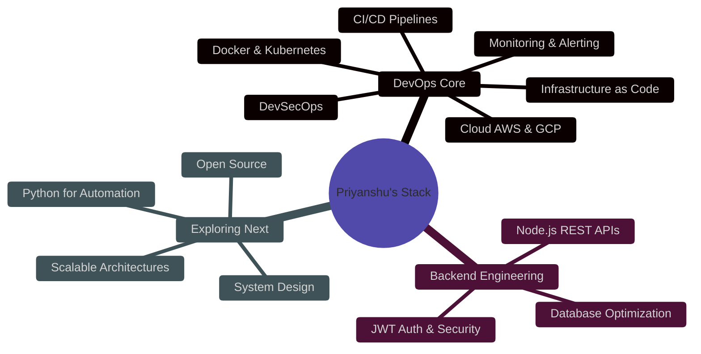

<p align="center">
  
</p>

<h1 align="center">
  
</h1>

<p align="center">
  
  
  
</p>

---

## 🌐 Connect With Me

<p align="center">
  <a href="mailto:priyanshugarg2525@gmail.com" target="_blank">
    
  </a>
  <a href="https://www.linkedin.com/in/priyanshu-garg25/" target="_blank">
    
  </a>
  <a href="https://github.com/Priyanshu-2545" target="_blank">
    
  </a>
  <a href="https://x.com/Priyans91292814" target="_blank">
    
  </a>
  <a href="https://priyanshugarg.tech/" target="_blank">
    
  </a>
</p>

<p align="center">
  <a href="https://leetcode.com/u/gargp6089/" target="_blank">
    
  </a>
  <a href="https://www.geeksforgeeks.org/profile/gargpeluc?tab=activity" target="_blank">
    
  </a>
  <a href="https://priyanshugarg.tech/" target="_blank">
    
  </a>
  <a href="mailto:priyanshugarg2525@gmail.com" target="_blank">
    
  </a>
</p>

---

## 🧠 About Me

```yaml
name      : Priyanshu Garg
role      : DevOps Engineer | Backend Engineer
location  : Udaipur, Rajasthan, India
college   : Geetanjali Institute of Technical Studies
degree    : B.Tech – Computer Science (2022 – 2026)
cgpa      : 8.27
focus:
  - Cloud Infrastructure (AWS, GCP)
  - Infrastructure as Code (Terraform)
  - Container Orchestration (Docker + Kubernetes / k3s)
  - CI/CD Pipeline Automation (GitHub Actions, Jenkins)
  - DevSecOps (Trivy, least-privilege IAM)
  - Monitoring & Observability
currently_exploring:
  - Python (for automation & scripting)
  - System Design at Scale
  - Open Source Contributions
  - Scalable Architectures
fun_fact  : "I turned a 2-hour deployment into 10 minutes. ⚡"
```

---

## 📈 Impact at a Glance

<div align="center">

| ⚡ Deploy Time | 🛰️ Manual Effort | 🐢➡️🚀 Query Speed | 📡 Assets Tracked | 💰 Ops Cost |
|:---:|:---:|:---:|:---:|:---:|
| **2 hrs → 10 min** | **-40%** | **4s → <800ms** | **10,000+** | **-80%** |

</div>

---

## 🛠️ Tech Arsenal

<details open>
<summary><b>☁️ Cloud & Infrastructure</b></summary>
<br>


**AWS:** EC2 · S3 · IAM · VPC · RDS · DynamoDB · CloudWatch &nbsp;|&nbsp; **GCP:** Compute Engine · IAM · Networking

</details>

<details open>
<summary><b>🐳 Containers & Orchestration</b></summary>
<br>


</details>

<details open>
<summary><b>🔁 CI/CD & Automation</b></summary>
<br>


</details>

<details open>
<summary><b>🔐 Security & 📊 Monitoring</b></summary>
<br>


</details>

<details open>
<summary><b>⚙️ Backend & Databases</b></summary>
<br>


</details>

<details open>
<summary><b>💻 Languages & Frontend</b></summary>
<br>


-3776AB?style=for-the-badge&logo=python&logoColor=white)


</details>

<details open>
<summary><b>🧰 Tools & AI Assistants</b></summary>
<br>


</details>

---

## 💼 Experience

<table>
<tr>
<td>

### 🛰️ India Space Lab (ISL) — *Remote*
**Technical Intern – GIS & Spatial Data Engineering** &nbsp;|&nbsp; `Feb 2026 – Mar 2026`

- Automated **6 Linux geospatial pipelines** with Bash → **40% less manual effort**
- Rewrote **3 slow PostGIS queries** with **GiST indexing** → **4s → under 800ms**
- Version-controlled pipeline scripts & cron configs in **Git**, added structured logs for faster debugging

`Linux` `Bash` `PostgreSQL / PostGIS` `Git` `Cron`

</td>
</tr>
</table>

---

## 🚀 Featured Projects

<table>
<tr>
<td width="50%" valign="top">

### 🔵 Cloud-Native CI/CD Pipeline
**Deployment time: 2 hrs → 10 mins ⚡**

`AWS EC2` `Docker` `Kubernetes` `Jenkins` `Nginx` `Prometheus` `Grafana`

- Built CI/CD with Jenkins & GitHub Webhooks
- Zero-downtime rolling updates on Kubernetes
- Nginx reverse proxy with pod-level load balancing
- Real-time CPU, memory & latency via Prometheus + Grafana

[](https://github.com/Priyanshu-2545)

</td>
<td width="50%" valign="top">

### 🎖️ SmarSetu – Digital Military Memorial Platform
**Live | Full-Stack + DevOps + IaC**

`Next.js 14` `TypeScript` `Prisma` `PostgreSQL` `NextAuth.js` `Docker` `Terraform` `k3s` `Traefik` `GitHub Actions` `Trivy` `AWS`

- Memorial platform covering **190+ soldiers, 109+ operations, 174+ regiments**
- Role-based admin dashboard (NextAuth.js) for moderation
- **Terraform**-provisioned AWS (EC2, S3, IAM) with least-privilege roles & budget alerts
- **4-stage GitHub Actions pipeline** (lint → audit → scan → deploy) → **70% faster deploys**
- **k3s** zero-downtime rolling updates, health probes, **Traefik + Let's Encrypt TLS**

[](https://smarsetu.app/)
[](https://github.com/Priyanshu-2545)

</td>
</tr>
<tr>
<td width="50%" valign="top">

### 🏆 SAMS – Smart Asset Monitoring System
**🥇 Winner – Smart India Hackathon 2024**

`Node.js` `Express.js` `MongoDB` `MySQL` `JWT` `REST APIs`

- Real-time GPS tracking of **10,000+ assets** (30s polling)
- **Dual-DB design** (MySQL metadata + MongoDB time-series) → **60% less query overhead**
- **80% reduction** in operational cost by replacing manual check-ins
- JWT + refresh-token secured APIs for enterprise-grade access control

</td>
<td width="50%" valign="top">

### 🟢 SUSTAINA – Utility Management System
**Live | Full-Stack + Real-time Dashboard**

`React.js` `Tailwind CSS` `Supabase` `PostgreSQL` `REST APIs`

- Real-time water & electricity usage dashboard per user
- Supabase Edge Functions handle concurrent reads — **no dedicated backend server**
- Per-user data isolation via **PostgreSQL Row Level Security (RLS)**
- Interactive data visualization & usage insights

[](https://github.com/Priyanshu-2545)

</td>
</tr>
</table>

---

## 🏗️ How I Ship (My Pipeline)


---

## 🏅 Achievements & Certifications

| Badge | Achievement |
|:---:|---|
| 🥇 | **National Winner** – Smart India Hackathon 2024 *(selected from 1,200+ teams)* |
| 🥇 | **1st Place** – Hack-Avishkar by Google Developer Student Clubs |
| 🌍 | **Global Top 10K** – Hacktoberfest 2025 Super Contributor |
| ☁️ | **AWS Cloud Quest: Cloud Practitioner** (Apr 2026) – EC2, VPC, RDS, S3, DynamoDB, IAM |
| 🌩️ | **Google Cloud Computing Foundations** (Apr 2026) – Compute Engine, IAM, Networking |
| 🎓 | **Full Stack Web Development (MERN)** – Grras Solutions |
| 🤝 | **Core Team Member** – GDG Udaipur \| Co-organized Google DevFest 2024 & 2025 (300+ attendees each) |

---

## 💡 What I'm Up To



---

## ⚡ GitHub Stats

<div align="center">


</div>

<div align="center">


</div>

---

<div align="center">

### 🤝 Let's Connect & Build Something Great

*"Infrastructure doesn't fail — it just finds creative ways to teach you."* 😄

<br/>

### 👀 Profile Visitors

<!-- Primary counter -->

<!-- Backup counter (works even if the first one is down) -->


<br/><br/>

<a href="mailto:priyanshugarg2525@gmail.com">
  
</a>

<br/><br/>


</div>


